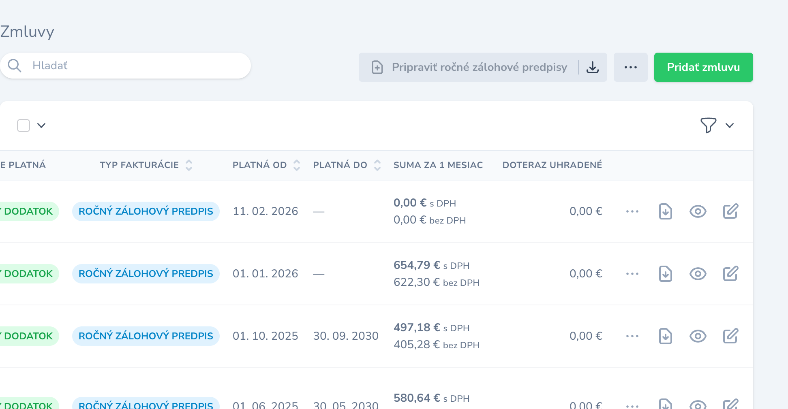
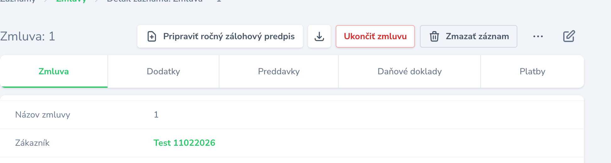
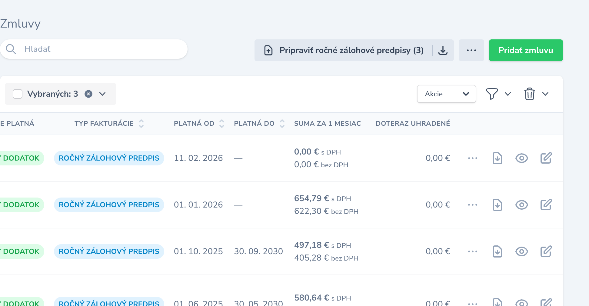
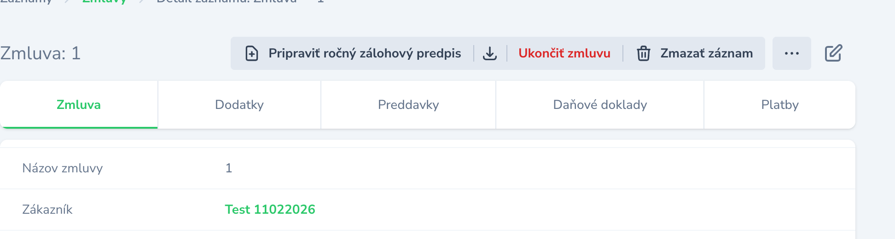
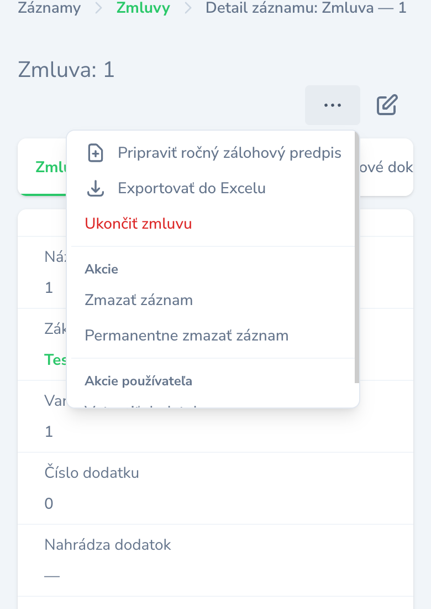
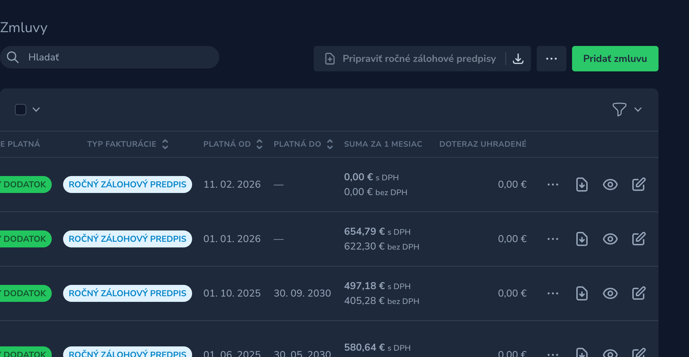
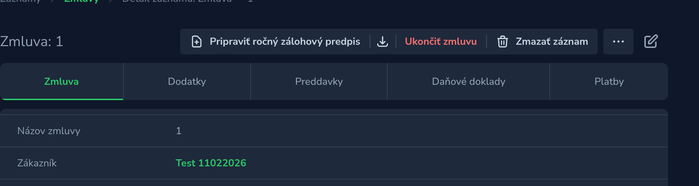

# Laravel Nova Action Toolbar

Choose, per Nova action, how it is shown: a **button**, an **icon** or the **⋯ menu**.
It works in all three places where Nova shows actions — above the index table, in a table
row and in the detail header — and for Nova's built-in controls too (preview, replicate,
view, edit, delete, restore, force delete, impersonate).

Nothing changes until you ask for it: an action without toolbar settings stays in ⋯,
and the built-in controls stay where Nova puts them.



*Screenshots come from a Slovak application.*

- **Button, icon or menu** per action and per place (`on: 'index' | 'inline' | 'detail'`).
- **Icons:** a [Heroicons](https://heroicons.com) v2 name or your own `<svg>`.
- **Styles:** `default`, `primary`, `outline`, `danger`, `ghost`, or your own text,
  background and border colours — each with a light and a dark variant.
- **Two layouts:** buttons in one grouped strip (default) or as separate buttons.
- **Narrow screens:** buttons that do not fit move into ⋯, the least important first.
- **Bulk actions as buttons:** disabled until rows are selected, then they show the count.
- **Nothing twice:** an action shown as a button leaves the ⋯ menu and Nova's bulk select.
- **Nova's own logic:** the confirm modal, the action fields, toasts, redirects and
  downloads are Nova's code, unchanged.

| Version | Nova | Branch |
|---|---|---|
| 5.x | 5.x (built against 5.11, tested on 5.6) | `main` |
| 4.x | 4.x (tested on 4.35) | `4.x` |

The PHP API is the same on both versions.

## Installation

```bash
composer require wamesk/laravel-nova-action-toolbar:^5.0   # Nova 5
composer require wamesk/laravel-nova-action-toolbar:^4.0   # Nova 4
```

The service provider registers itself and loads the assets into Nova. To change the
layout, publish the config:

```bash
php artisan vendor:publish --tag=nova-action-toolbar-config
```

```php
// config/nova-action-toolbar.php
return [
    'layout' => env('NOVA_ACTION_TOOLBAR_LAYOUT', 'grouped'), // 'grouped' | 'separate'
];
```

## Actions

Every Nova action gets these methods (macros on `Laravel\Nova\Actions\Action`):

| Method | What it does |
|---|---|
| `showAsButton(on: null, style: null)` | A button with the label (and the icon, if set). |
| `showAsIcon(icon: null, on: null, style: null)` | An icon-only button. The label becomes the tooltip and the accessible name. |
| `showInMenu(on: null)` | Back into ⋯ (the default) — useful to undo a placement in one place. |
| `withIcon(string $icon)` | A Heroicons name or a raw `<svg>` string. |
| `buttonStyle(string $style)` | `default`, `primary`, `outline`, `danger` or `ghost`. |
| `buttonColors(text:, background:, border:, dark: [])` | Your own colours. Switches the style to `custom`. |
| `priority(int $priority)` | On a narrow screen, a higher priority stays visible longer. |

`on` is `'index'`, `'inline'`, `'detail'`, a list of them, or `null` for everywhere.
The placement only says **how** an action is drawn; **where** it appears is still Nova's
`onlyOnIndex()`, `onlyOnDetail()`, `showInline()` and `standalone()`.

```php
public function actions(NovaRequest $request): array
{
    return [
        // A button on the index and on the detail, with a Heroicon.
        (new PrepareAnnualAdvance)->showAsButton()->withIcon('document-plus'),

        // Icon only, above the table.
        (new ExportContracts)->standalone()->showAsIcon('arrow-down-tray'),

        // Icon in each table row, still in ⋯ on the detail.
        (new DownloadContractPdf)->showInline()->showAsIcon('document-arrow-down', on: 'inline'),

        // Different styles per place: a button on the detail, an icon in the row.
        (new CreateAnnex)
            ->showInline()
            ->showAsButton(on: 'detail', style: 'outline')
            ->showAsIcon('document-duplicate', on: 'inline'),

        (new TerminateContract)->onlyOnDetail()->showAsButton(style: 'danger')->priority(10),

        // Your own colours, with a dark variant.
        (new RecalculateVariableSymbols)
            ->showAsButton()
            ->buttonColors(
                text: '#065f46',
                background: '#d1fae5',
                border: '#6ee7b7',
                dark: ['text' => '#a7f3d0', 'background' => '#064e3b', 'border' => '#047857'],
            ),

        // Your own SVG instead of a Heroicon.
        (new SendToPortal)->showAsIcon('<svg viewBox="0 0 24 24" fill="none" stroke="currentColor" stroke-width="1.5"><path d="M4 12h16M12 4v16"/></svg>'),

        // No toolbar call: stays in ⋯, exactly as before.
        new SendReminder,
    ];
}
```



### Bulk actions as buttons

A bulk action (`standalone` is `false`) shown on the index needs selected rows. Its
button is disabled until at least one row is selected — the tooltip says why — and then
shows the count, e.g. *Prepare annual advances (3)*. Clicking it opens the same confirm
modal as the ⋯ menu. The action leaves Nova's bulk select, so it is never offered twice.



### Actions with fields in a table row

Nova puts a row's actions, fields included, into the index response — a request that
names no record. An action whose fields depend on the record (select options, a pre-filled
amount) would open from a row with empty fields. So when an action **with fields** is
picked in a row (icon, button or ⋯), the toolbar first asks Nova's actions endpoint for that
one row, the way the detail page does, and opens the form with the answer:

```
GET /nova-api/{resource}/actions?resourceId={id}&editing=true&editMode=create
    [&viaResource=…&viaResourceId=…&viaRelationship=…]
```

In `fields()`, read the record from `$request->resourceId`, as on the detail page. The
icon (or ⋯) shows a spinner while the form loads. If the request fails, the form opens as
Nova sent it with the page and an error toast says so. Actions without fields, the index
toolbar and the detail page send no extra request.

## Built-in controls

Add a static `toolbarControls()` method to a Nova resource. Each control takes the same
methods as an action:

```php
use Wame\LaravelNovaActionToolbar\Control;

class Contract extends Resource
{
    public static function toolbarControls(): array
    {
        return [
            // Delete leaves the row icons and goes into the row's ⋯.
            Control::delete()->showInMenu(on: 'inline'),

            // Replicate becomes a button on the detail.
            Control::replicate()->showAsButton(on: 'detail')->withIcon('document-duplicate'),

            // Preview as an icon in each row.
            Control::preview()->showAsIcon(on: 'inline'),
        ];
    }
}
```

| Control | Nova's default in a row | Nova's default on the detail |
|---|---|---|
| `Control::preview()` | ⋯ | — |
| `Control::replicate()` | ⋯ | ⋯ |
| `Control::impersonate()` | ⋯ | ⋯ |
| `Control::view()` | icon | icon (on related screens) |
| `Control::edit()` | icon | icon |
| `Control::delete()` | icon | ⋯ |
| `Control::restore()` | icon | ⋯ |
| `Control::forceDelete()` | — | ⋯ |

Who may use a control is still decided by Nova (`authorizedToView`, `authorizedToDelete`,
…). A control Nova does not render for the user is not offered anywhere.



## Layouts

`grouped` (the default) puts the buttons in one strip with a slightly darker background
and thin dividers; ⋯ is its own tile at the end. `separate` draws separate buttons with a
gap. Table rows always look like Nova's row icons.


## Narrow screens

The index and the detail toolbar measure themselves. Buttons that do not fit move into
⋯ — the lowest `priority()` first, and among equal priorities the last one first. In ⋯
they appear at the top, with their icon. ⋯ disappears when it has nothing to show.



## Dark mode

Every style follows Nova's theme switch. Colours come from Nova's own CSS variables, so the
brand colour of your Nova follows too.





## Security

- A button is a different drawing of the same action. Nova decides which actions it sends
  to the page (`canSee`, `canRun`, the policy's `runAction`), and the button runs the same
  request as the menu item, so the server checks it again.
- A raw `<svg>` is inserted as markup. The package keeps only drawing elements and
  attributes — no scripts, event handlers, links or inline styles — but treat it as code:
  never build it from user input.
- Colours go into an inline `style`, so only colour syntax is accepted (`#hex`, `rgb()`,
  `hsl()`, colour names, `var(--…)`).

## How it works

The package replaces five Nova components when Nova boots: `ActionDropdown`,
`InlineActionDropdown`, `DetailActionDropdown`, `ActionSelector` and
`CreateResourceButton`. Nova registers its own components afterwards and skips names that
are already taken, so no Nova file is edited.

- Running an action is Nova's `useActions` composable, and deleting / restoring is Nova's
  `Deletable` mixin — both compiled from the installed Nova source at build time.
- The index header toolbar lives next to the create button: Nova renders its header action
  dropdown only for standalone actions, while a bulk button must be visible before any
  row is selected.
- View, edit, delete and restore in a row (and view / edit on the detail) are drawn by
  Nova's own templates. A moved control is hidden with CSS, and its new button or menu
  item clicks Nova's hidden element — Nova's link, modal and authorization run unchanged.

**After a Nova upgrade, rebuild the assets** (`npm ci && npm run production`): the bundle
contains Nova's action runner from the version it was built against.

## Development

```bash
composer install     # Nova comes from nova.laravel.com — needs your Nova credentials
npm ci
npm run production   # builds dist/ — commit it
./vendor/bin/pest
```

`nova.mix.js` takes Nova's source from `NOVA_PATH`, then from the package's own `vendor/`,
then from the `vendor/` of an application that holds the package in a sub-folder. Build
`dist/` against the Nova major of the branch: Nova 4 on `4.x`, Nova 5 on `main`.

Inside an application that holds the package in `wamesk/`, run the tests from the
application root:

```bash
./vendor/bin/pest --test-directory=wamesk/laravel-nova-action-toolbar/tests \
                  -c wamesk/laravel-nova-action-toolbar/phpunit.xml
```

## License

Proprietary — © WAME s.r.o.
